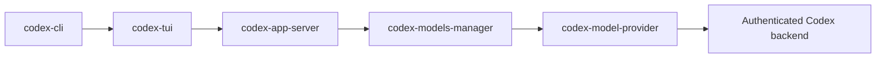

# Agent UI fork architecture

Version: **0.170.0-agent-ui.1** | Updated: 2026-11-18

This document scopes the fork's additions and build identity. The upstream workspace remains
the authority for unrelated Codex components. This is a development fork, not the official
0.170.0 release; its original upstream source base is `42248f5ef988883cebce298c2279ce22cb536726`.

## Components and dependencies

The TUI owns parent-scoped presentation and selection. App-server notifications supply
lineage, turn state, model settings, and usage. Models manager owns catalog caching and
version identity; model-provider fetches the authenticated catalog.

## Decisions

The fork uses the normal Cargo workspace version to identify its build. A prerelease suffix
distinguishes it from the official client. `client_version_to_whole()` sends `0.170.0` to the
catalog endpoint using its existing normalization logic. We retain server authorization and
the TUI's catalog validation; no model name is force-added or injected from another account.

The source-build placeholder `0.0.0` caused a fresh server response to omit newer models.
An A/B query under the same demo credentials returned six models for `0.0.0`, and twelve
for `0.170.0`. This is catalog version gating, not evidence of a subscription denial.

See [panel architecture and contracts](subagent-panel.md), [data flow](DATAFLOW.md),
[developer guide](DEVELOPER.md), and [security boundaries](SECURITY.md).

## Version history

| Version            | Change                                                             |
| ------------------ | ------------------------------------------------------------------ |
| 0.170.0-agent-ui.1 | Mark the fork build and use a meaningful catalog client version    |
| 0.0.0              | Earlier development builds and their historical evaluation records |
