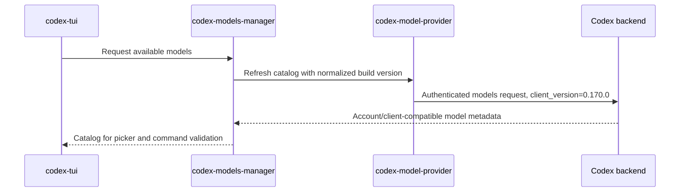

# Agent UI fork data flow

Version: **0.170.0-agent-ui.2** | Updated: 2026-11-18

## Catalog flow

The cache records client version and identity. Existing eligibility checks reject a cache
from a different version or identity. The build change relies on the existing refresh path;
it does not copy the installed client's cache into the fork.

`/model` resolves names against the available catalog before selecting a model. A successful
selection alone does not prove backend access: a real response must also succeed.

## Agent panel flow

The `.2` candidate also imports upstream sidebar-agent discovery and history outcome replay.
Both it and the inline panel must preserve parent scope and agree on lifecycle state.

Spawn lineage and app-server notifications feed a parent-family presentation cache. Filters
select visible rows without changing the viewed transcript. Explicit completion survives
subscription unload; actual new turns replace prior outcomes. See the
[status specification](subagent-panel-status-filter-spec.md) for the complete state contract.

## Storage and lifecycle

Runtime preparation reads the tracked companion manifest, verifies package SHA-512 integrity,
streams only the pinned archive member, verifies its SHA-256, checks transport support, then links
it beside the CLI. It neither reads nor modifies login credentials. Voice assets are outside this recipe.

`models_cache.json` contains fetched model metadata, version, timestamp, ETag, and identity.
Authentication remains in the user's existing credential store. Evaluation uses isolated
temporary HOME/CODEX_HOME directories; credentials and raw session files are not published.

## Version history

The earlier `.1` changed build-version input to the catalog flow. Candidate `.2` imports new
upstream lifecycle, approval-routing and sandbox-launch paths; see the maintenance record.
