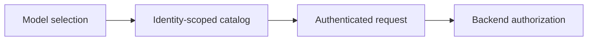

# Agent UI fork security boundaries

Version: **0.170.0-agent-ui.2** | Updated: 2026-11-18

## Trust model

The existing subscription/API authentication remains authoritative. A client-version query
affects catalog compatibility, not account identity or permission to execute a model request.
The backend still authorizes requests; the TUI still validates selections against its catalog.
The earlier `.1` identity fix widened no account permissions. Candidate `.2` imports upstream
approval-routing and sandbox refactors. These security-sensitive paths require qualification;
managed requirements remain authoritative and user settings are not changed by the merge.

## Data handling

Credentials stay in existing credential files or stores. Local evaluation scripts load them
in process without printing them, and publish only model names, statuses, and hashes.
Demo credentials, raw request/session logs, and unredacted recordings are excluded from Git.
The shareable recording crops unrelated application content and masks host notifications.

Runtime preparation fetches a public official npm artifact without account credentials. A tracked
SHA-512 integrity pin is checked before reading its single helper member, and a separate SHA-256
pin is checked before execution. This is checksum verification, not a claim that npm provenance
signatures were independently verified. The script does not unpack arbitrary archive paths and
protects existing regular helper files. Runtime bytes are cached locally rather than committed.

SHA-256 evidence hashes identify source, executable, and media artifacts; they are integrity
references, not signatures or proof of production certification. This fork introduces no new
cryptographic scheme and makes no compliance-certification claim.

Child approvals remain subject to existing user/policy decisions. Inspecting a parent-managed
child does not grant direct-input permission. Turn interruption is distinct from process or
agent-lifetime termination.

## Version history

Candidate `.2` imports upstream approval/sandbox updates. Earlier `.1` labeled the fork and
corrected the existing catalog version input.
See the repository's root SECURITY.md for upstream vulnerability-reporting policy.
